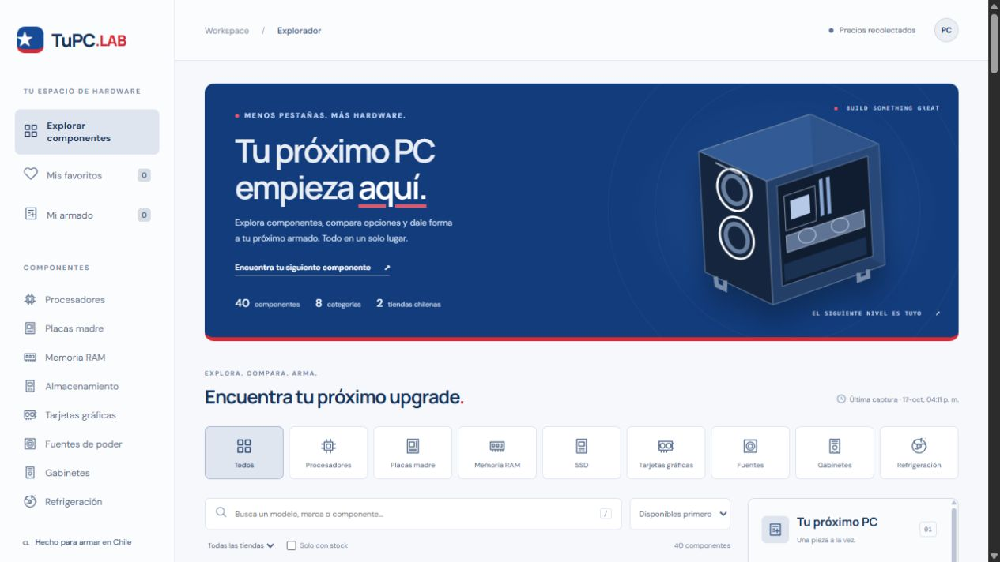

# TuPC.LAB — Explorador de componentes para PC



**Python · BeautifulSoup · SQLite · JavaScript · HTML/CSS**

Desarrollé TuPC.LAB para reunir componentes de PC de tiendas chilenas en una sola web y facilitar la comparación de opciones al armar un equipo. En este proyecto combiné recolección de datos con Python, almacenamiento en SQLite y una interfaz en JavaScript.

Tomé como referencia la idea de los comparadores de hardware y la llevé a una aplicación con catálogo, historial de precios y un armador con presupuesto. Es un proyecto independiente, sin afiliación a SoloTodo.

## Mi enfoque

Quise que la aplicación se pudiera usar directamente desde el navegador, **sin instalar nada**. Por eso separé la recolección de precios de la interfaz: ejecuto el recolector por separado y la web consume un catálogo JSON. Guardé los favoritos, el presupuesto y el armado en el navegador mediante localStorage.

## Funciones

Implementé las siguientes funcionalidades:

- 8 categorías: procesadores, placas madre, RAM, SSD, GPU, fuentes, gabinetes y refrigeración.
- Catálogo ampliado a 62 productos: 16 procesadores y 14 placas madre, además de las otras seis categorías.
- Búsqueda, filtro por categoría/tienda/stock y orden por precio o nombre.
- Comparación de hasta 3 componentes, favoritos persistentes y fichas con fuente.
- Armador de una pieza por categoría, presupuesto y exportación TXT con enlaces.
- Advertencias de incompatibilidad de socket y generación de RAM cuando esos datos están disponibles.
- Historial de lecturas reales en SQLite; nunca se generan precios ni tendencias ficticias.
- Diseño adaptable a móvil, navegación por teclado y diálogos accesibles.

## Stack principal

Elegí estas tecnologías para construir el proyecto:

| Capa | Tecnologías | Uso en el proyecto |
| --- | --- | --- |
| Frontend | HTML5, CSS3 y JavaScript ES Modules | Interfaz responsive, filtros, comparación y armador de PC, sin frameworks. |
| Datos en el navegador | Fetch API, JSON y localStorage | Carga del catálogo y persistencia de favoritos, presupuesto y armado. |
| Recolección de precios | Python 3.11+, BeautifulSoup4 y urllib | Extracción de HTML, consulta de catálogos públicos y normalización de productos. |
| Base de datos | SQLite | Historial local de observaciones de precio y disponibilidad. |
| Desarrollo local | Node.js 20+ y npm | Servidor estático y comandos para ejecutar el recolector y las pruebas. |
| Pruebas | unittest de Python | Validación del scraping, precios, stock e historial. |
| Control de versiones | Git y GitHub | Historial de cambios y publicación del código fuente. |

Organicé la aplicación como una web estática que consume el JSON generado por mi recolector. Esto permite servir la interfaz sin mantener un servidor de Python en producción.

## Cómo ejecuto el proyecto

Para trabajar en la web localmente uso Node.js 20+ y este comando, sin instalar paquetes npm adicionales:

```powershell
npm run dev
```

Después abro http://127.0.0.1:4173. Incluí una captura del catálogo en el repositorio para que la interfaz pueda probarse sin ejecutar primero el scraper.

También puedo servir la web con Python: `python -m http.server 4173 --bind 127.0.0.1 --directory dist`.

## Cómo actualizo los precios

Para recolectar los datos uso Python 3.11+. En Windows preparo el entorno y ejecuto:

```powershell
python -m venv .venv
.\.venv\Scripts\python.exe -m pip install -r requirements.txt
npm run scrape
npm test
```

En macOS/Linux preparo el entorno con `python3 -m venv .venv` y `.venv/bin/python -m pip install -r requirements.txt`. El comando npm detecta el entorno virtual según el sistema.

Mi recolector actualiza `data/prices.db` y `dist/data/catalog.json`. Puedo cambiar el tamaño de la muestra con `npm run scrape -- --limit 6` (entre 2 y 12 productos por categoría y tienda). La selección ampliada se conserva aparte de ese límite y se vuelve a comprobar en cada captura. La extracción demora unos 30 segundos por las pausas entre solicitudes.

Por ahora ejecuto las actualizaciones manualmente. **La web publicada no ejecuta el recolector**: después de una nueva captura actualizo los archivos estáticos. Incluí la fecha de lectura y una advertencia cuando los datos superan las 48 horas.

## Arquitectura

Separé el flujo de datos en recolección, almacenamiento y presentación:

```text
Alltec (HTML/microdatos) ─┐
                        ├─ Python + BeautifulSoup ─ SQLite ─ catálogo JSON
Chile Setup (API pública)┘                                      │
                                                     Web estática
```

```text
dist/                 Web publicable, sin secretos ni base de datos
  data/catalog.json   Snapshot de precios + historial exportado
scraper/
  collect.py          Adaptadores, robots.txt, selección y exportación
  database.py         Observaciones SQLite
data/prices.db        Historial local (ignorado por Git)
tests/                Pruebas unitarias sin red
scripts/              Servidor local y lanzador Python multiplataforma
```

## Fuentes y alcance

Trabajo con datos públicos de estas fuentes y mantengo el siguiente alcance:

- **[Alltec](https://www.alltec.cl/):** extraigo del HTML de la primera página de cada subcategoría el título completo, precio, disponibilidad, imagen y URL.
- **[Chile Setup](https://chilesetup.cl/):** consulto la API pública de WooCommerce Store y selecciono fuentes, gabinetes y refrigeración desde la primera página de hasta 100 artículos.
- Mantengo una muestra base de cuatro productos por categoría y tienda y añadí una selección de procesadores y placas documentada en `scraper/catalog_expansion.json`. Solo incorporo las parejas adicionales si ambos productos tienen stock en la captura y coinciden en plataforma. No cubro todo el mercado y algunos artículos pueden estar agotados.
- Mantengo la tienda de origen en cada ficha. Todavía no unifico productos de distintas tiendas por SKU ni identifico el mejor precio de todo el mercado.
- Muestro los precios publicados en CLP, sin envío. Las condiciones de pago y la disponibilidad final se consultan en la tienda.
- Configuré la consulta de robots.txt y una pausa mínima de dos segundos por dominio, respetando valores mayores de crawl-delay. No implementé evasión de bloqueos 403/429 ni CAPTCHAs. Ante un fallo conservo la lectura anterior con `stale: true`, registro el error y termino el proceso con código 1.
- Enlazo las imágenes desde la fuente y muestro una alternativa visual si dejan de cargar. Las imágenes y nombres pertenecen a sus respectivos titulares.
- Implementé comprobaciones parciales de compatibilidad para socket y generación DDR. Dejé BIOS, dimensiones, conectores, potencia y refrigeración para revisión manual. Algunos procesadores incluyen cooler; no incluí periféricos ni sistema operativo en esta versión.
- Guardo las observaciones en `data/prices.db` con cada ejecución. Ese archivo conserva el historial local y queda fuera del control de versiones.

## Pruebas

Para comprobar el código ejecuto:

```powershell
npm run check
npm test
```

Incluí nueve pruebas que cubren la extracción de precios y stock, los cambios de estructura del HTML, la exclusión de accesorios, la deduplicación, las características de los componentes, la idempotencia del historial, la conservación de datos ante errores y la exclusión de parejas sin stock o con sockets diferentes.
